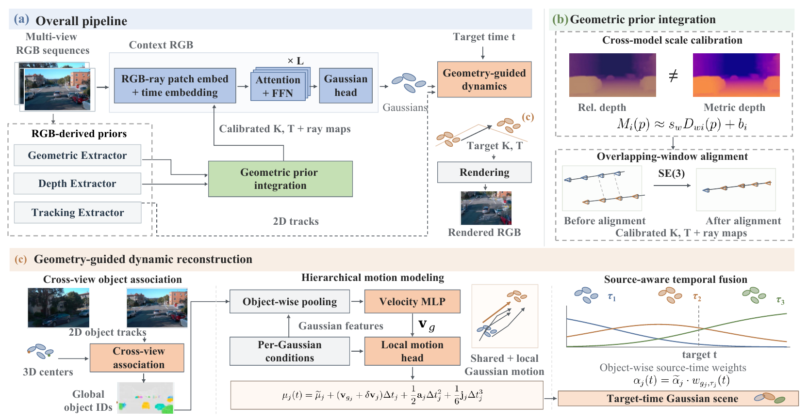

<h3 align="center">FreeForward4D: Annotation-Free Feed-Forward 4D Reconstruction of Driving Scenes</h3>

<p align="center">
  <a href="https://max-luo-song.github.io/gls2000.github.io/"><strong>Luosong&nbsp;Guo</strong></a><sup>1,2,*</sup> &nbsp;·
  <a href="https://akkzzzz.github.io/"><strong>Xiang&nbsp;Yang</strong></a><sup>1,2,*</sup> &nbsp;·
  <a href="https://github.com/GiIfoyle"><strong>Chaoyang&nbsp;Li</strong></a><sup>1,2</sup> &nbsp;·
  <a href="https://yuhuoo.github.io/"><strong>Ao&nbsp;Gao</strong></a><sup>1</sup> &nbsp;·
  <a href="https://faculty.ecnu.edu.cn/_s16/sjm2/main.psp"><strong>Jiangming&nbsp;Shi</strong></a><sup>1</sup> &nbsp;·
  <a href="https://scholar.google.com/citations?user=idiP90sAAAAJ&amp;hl=en"><strong>Yanyun&nbsp;Qu</strong></a><sup>3</sup> &nbsp;·
  <a href="https://faculty.ecnu.edu.cn/_s16/zzz2/main.psp"><strong>Zhizhong&nbsp;Zhang</strong></a><sup>1</sup> &nbsp;·
  <a href="https://jingyugong.github.io"><strong>Jingyu&nbsp;Gong</strong></a><sup>1</sup> &nbsp;·
  <a href="https://scholar.google.com/citations?user=RN1QMPgAAAAJ&amp;hl=en&amp;oi=ao"><strong>Yuan&nbsp;Xie</strong></a><sup>1,2,†</sup>
</p>

<p align="center">
  <sup>1</sup> East China Normal University &nbsp;·&nbsp; <sup>2</sup> Shanghai Innovation Institute &nbsp;·&nbsp; <sup>3</sup> Xiamen University
  <br><em>* Equal contribution. † Corresponding author.</em>
  <br><em>Work done during Xiang Yang’s internship at SII.</em>
</p>

<p align="center">
  
  &nbsp;&nbsp;&nbsp;&nbsp;
  
</p>

<p align="center">
  <a href="https://arxiv.org/pdf/2611.24007"></a>
  <a href="https://max-luo-song.github.io/FreeForward4D/"></a>
  <a href="https://huggingface.co/Dwqy/FreeForward4D/tree/main"></a>
</p>

<p align="center">
  <a href="#quick-start"><strong>Quick Start</strong></a> &nbsp;·&nbsp;
  <a href="#installation">Installation</a> &nbsp;·&nbsp;
  <a href="#dataset-support">Dataset Support</a> &nbsp;·&nbsp;
  <a href="#inference">Inference</a> &nbsp;·&nbsp;
  <a href="#training">Training</a>
</p>

## Overview

FreeForward4D reconstructs dynamic driving scenes using RGB-derived camera estimates, MoGe-2 depth predictions, and object tracks. The geometry frontend jointly estimates window scales and shared per-image depth offsets, then aligns overlapping camera predictions. The reconstruction network combines shared object velocity with local Gaussian trajectories and temporal weighting.



## Release status

- [x] Release the paper on arXiv
- [x] Release the inference framework
- [x] Release the training framework
- [x] Upload pretrained FreeForward4D weights to [Hugging Face](https://huggingface.co/Dwqy/FreeForward4D/tree/main) (access currently restricted)

## Quick Start

Run one 2-second reconstruction on a Waymo validation scene with a single CUDA GPU.

**Before you start.** Complete [Installation](#installation), including the visual-prior weights, and set up the separate [Waymo TFRecord environment](#waymo) with `RAW_PYTHON` exported. Have one Waymo validation `.tfrecord` ready and download the Waymo 2s checkpoint using [Pretrained weights](#pretrained-weights).

### 1. Prepare one validation scene

From the repository root, point `--raw-root` at a directory containing your validation TFRecord. Use a fresh output directory for this example so scene index `0` refers to the clip you just prepared.

```bash
export FREEFORWARD_DATA_ROOT="$PWD/data/quickstart_waymo"

bash scripts/prepare_data.sh \
  --dataset waymo --split val \
  --raw-root /path/to/waymo/validation \
  --output "$FREEFORWARD_DATA_ROOT" \
  --geometry-config configs/preprocessing.json \
  --limit-scenes 1 --gpus 0
```

This extracts the three front cameras and generates predicted cameras, depth, and object tracks. Skip this step if `FREEFORWARD_DATA_ROOT` already points to a prepared validation dataset, and select the corresponding scene index below.

### 2. Reconstruct and view the result

```bash
bash scripts/infer.sh --config configs/inference_2s.json \
  --checkpoint weights/FreeForward4D/ckpts/waymo_2s.pth \
  --scene_id 0 --start_idx 0 --output_dir outputs/quickstart
```

Open `outputs/quickstart/scene_00000_start_000.mp4` for the three-view rendering. The same output directory contains the rendered frames and metrics JSON. See [Inference](#inference) for the 8s configuration and evaluation options.

## Installation

<details>
<summary>Hardware and CUDA requirements</summary>

| Task | Configuration |
| --- | --- |
| Training | 8 × NVIDIA H200 on one node |
| RGB geometry preprocessing | One or more CUDA GPUs; approximately 40 GB free VRAM is recommended for 20-frame, three-camera windows |
| Reconstruction inference | One CUDA GPU; a 48 GB RTX 4090 is used for release smoke tests |

Training uses BF16 and CUDA 12.8-compatible PyTorch. Install a CUDA development toolkit and a C++ compiler to build the `gsplat` rasterizer. See [H200 launch details](guides/TRAINING.md).

</details>

```bash
git clone https://github.com/Max-luo-song/FreeForward4D.git
cd FreeForward4D
conda create -n freeforward python=3.10 -y
conda activate freeforward
bash scripts/setup.sh
bash scripts/setup_priors.sh
python scripts/download_priors.py
python scripts/check_environment.py --rasterizer-smoke
```

The setup uses PyTorch 2.10.0 / torchvision 0.25.0 with CUDA 12.8 wheels and `gsplat==1.5.3`. External model sources are pinned in `scripts/setup_priors.sh`. Do not copy a compiled rasterizer between H200 and RTX 4090 machines; build it for each node's architecture.

<details>
<summary>Visual priors and their checkpoints</summary>

The release includes the inference integration for **all four visual priors**. `scripts/setup_priors.sh` fetches their source code at pinned revisions and installs the dependencies; `scripts/download_priors.py` downloads the external checkpoints. The multi-GPU preprocessing command then runs these models automatically.

| Model | Role | Default checkpoint location | Inference integration |
| --- | --- | --- | --- |
| VGGT-Omega | Camera and relative geometry predictions | `weights/vggt_omega_1b_512.pt` | `freeforward/preprocessing/pose/` |
| MoGe-2 | Metric depth for scale calibration and reconstruction supervision | `weights/moge-2-vitl/model.pt` | `freeforward/preprocessing/depth.py` and `pose/` |
| Grounding DINO | RGB object detection | `weights/grounding-dino-tiny/` | `freeforward/preprocessing/tracking.py` |
| SAM 2.1 | Object segmentation and tracking | `weights/sam2.1_hiera_large.pt` | `freeforward/preprocessing/tracking.py` |

The downloader also provides VGG16 and LPIPS weights used by the training losses. Model binaries are downloaded into the ignored `weights/` directory; they are not stored in Git. After installation and download, no separate manual MoGe or SAM inference step is needed.

VGGT-Omega checkpoints require access approval from the original publisher. Request access at [facebook/VGGT-Omega](https://huggingface.co/facebook/VGGT-Omega), run `hf auth login`, then download. To reuse an authorized checkpoint:

```bash
python scripts/download_priors.py --omega-checkpoint /path/to/vggt_omega_1b_512.pt
```

The script downloads **external visual-prior and perceptual weights**, not the FreeForward4D reconstruction weights hosted in [Dwqy/FreeForward4D](https://huggingface.co/Dwqy/FreeForward4D/tree/main). The selected Omega checkpoint is the 512-resolution model used by this frontend; changing it also changes the preprocessing configuration.

</details>

Set the paths used by the examples below. Use a separate data root for each dataset.

```bash
export FREEFORWARD_DATA_ROOT="$PWD/data/waymo"
export FREEFORWARD_WEIGHTS_ROOT="$PWD/weights"
export FREEFORWARD_RUN_ROOT="$PWD/runs"
export FREEFORWARD_VGG16_WEIGHTS="$FREEFORWARD_WEIGHTS_ROOT/vgg16-397923af.pth"
export FREEFORWARD_LPIPS_CKPT="$FREEFORWARD_WEIGHTS_ROOT/lpips_vgg.pth"
```

## Dataset Support

| Dataset | Download | Preparation |
| --- | --- | --- |
| Waymo Open Dataset | [Official portal](https://waymo.com/open/download/) | [Waymo TFRecords](#waymo) |
| nuScenes | [Official portal](https://www.nuscenes.org/download) | [nuScenes RGB export](#nuscenes) |
| Argoverse 2 Sensor | [Official portal](https://www.argoverse.org/av2.html) | [Argoverse 2 via synchronized RGB folders](#argoverse-2) |

### Waymo

<details>
<summary>Prepare train and validation splits from TFRecords</summary>

Raw Waymo TFRecord conversion uses a separate CPU environment because its TensorFlow/NumPy requirements differ from the reconstruction environment:

```bash
conda create -n freeforward-data python=3.10 -y
conda run -n freeforward-data python -m pip install -r requirements-data.txt
export RAW_PYTHON="$(conda run -n freeforward-data python -c 'import sys; print(sys.executable)')"
```

The following command optionally downloads authorized TFRecords, extracts only frontal RGB images and timestamps, and produces predicted cameras, MoGe-2 depth, and object tracks. Omit `--download-source` when the records are already available.

```bash
bash scripts/prepare_data.sh \
  --dataset waymo --split train \
  --raw-root /datasets/waymo_raw/training \
  --download-source gs://YOUR_AUTHORIZED_WAYMO_TFRECORD_PREFIX/training \
  --output "$FREEFORWARD_DATA_ROOT" \
  --geometry-config configs/preprocessing.json \
  --gpus 0,1,2,3,4,5,6,7

bash scripts/prepare_data.sh \
  --dataset waymo --split val \
  --raw-root /datasets/waymo_raw/validation \
  --output "$FREEFORWARD_DATA_ROOT" \
  --geometry-config configs/preprocessing.json \
  --gpus 0,1,2,3,4,5,6,7
```

Use the actual prefix granted to your dataset account. HTTPS tar/zip archives are also supported by `scripts/download_data.py`; see [data and cache formats](guides/DATA.md).

</details>

### nuScenes

<details>
<summary>Export and preprocess the three front cameras</summary>

Use the full nuScenes dataset with its metadata and camera images. Repeat with `--split train` if preparing training data.

```bash
bash scripts/prepare_data.sh \
  --dataset nuscenes --split val \
  --raw-root /datasets/nuscenes \
  --output "$PWD/data/nuscenes" \
  --geometry-config configs/preprocessing.json --gpus 0
```

</details>

### Argoverse 2

<details>
<summary>Import Argoverse 2 Sensor images through the RGB workflow</summary>

Export synchronized triplets from `ring_front_left`, `ring_front_center`, and `ring_front_right` into folders `1`, `0`, and `2`, respectively. Follow the [RGB folder layout](#existing-rgb-folders) below. Use a separate output root such as `data/argoverse2`, and set `--fps` to the rate of the exported sequence. For the 10 Hz Waymo recipe, subsample the 20 Hz image stream to 10 Hz after synchronization. This path uses the generic RGB importer and requires you to export the triplets first.

</details>

### Existing RGB folders

<details>
<summary>Folder layout and preprocessing command</summary>


Use three synchronized camera folders named `1` (front-left), `0` (front), and `2` (front-right):

```text
rgb/
  scene_a/
    1/000000.jpg ...
    0/000000.jpg ...
    2/000000.jpg ...
```

```bash
python -m freeforward.preprocessing \
  --input /datasets/rgb --output "$FREEFORWARD_DATA_ROOT" \
  --split train --fps 10 --gpus 0,2,4,6 \
  --geometry-config configs/preprocessing.json
```

`--num-gpus 4` selects the first four visible GPUs instead. `--stages geometry,depth,tracks` is the default; a subset can be selected. The same command resumes completed scenes and cached outputs. Use a new output directory when changing the input or model settings.

```bash
# Inspect a plan without loading models or using GPUs.
python -m freeforward.preprocessing --output data/example --num-gpus 8 --dry-run
```

Preprocessing uses the supplied RGB clip, including frames outside the reconstruction network's sparse context set. It never uses dataset camera calibration, depth, or 3D object trajectories. The generated scene JSON files contain image paths and timing metadata. Depth and tracking are frozen-model predictions stored separately.

</details>

## Pretrained weights

Reconstruction checkpoints are hosted in [Dwqy/FreeForward4D](https://huggingface.co/Dwqy/FreeForward4D/tree/main). The weights repository is currently private; downloading requires an authorized Hugging Face account. The project website and paper remain publicly accessible.

```bash
python -m pip install -U huggingface_hub
hf auth login
hf download Dwqy/FreeForward4D ckpts/waymo_2s.pth --local-dir weights/FreeForward4D
```

| Dataset | Window | Checkpoint | Configuration |
| --- | --- | --- | --- |
| Waymo | 2s | [`ckpts/waymo_2s.pth`](https://huggingface.co/Dwqy/FreeForward4D/blob/main/ckpts/waymo_2s.pth) | `configs/inference_2s.json` |
| Waymo | 8s | [`ckpts/waymo_8s.pth`](https://huggingface.co/Dwqy/FreeForward4D/blob/main/ckpts/waymo_8s.pth) | `configs/inference_8s.json` |
| nuScenes | 2s | [`ckpts/nuscenes_2s.pth`](https://huggingface.co/Dwqy/FreeForward4D/blob/main/ckpts/nuscenes_2s.pth) | `configs/inference_2s.json` |
| nuScenes | 8s | [`ckpts/nuscenes_8s.pth`](https://huggingface.co/Dwqy/FreeForward4D/blob/main/ckpts/nuscenes_8s.pth) | `configs/inference_8s.json` |
| Argoverse 2 | 2s | [`ckpts/argoverse_2s.pth`](https://huggingface.co/Dwqy/FreeForward4D/blob/main/ckpts/argoverse_2s.pth) | `configs/inference_2s.json` |
| Argoverse 2 | 8s | [`ckpts/argoverse2_8s.pth`](https://huggingface.co/Dwqy/FreeForward4D/blob/main/ckpts/argoverse2_8s.pth) | `configs/inference_8s.json` |

To download all six checkpoints, omit the filename from `hf download`. Each checkpoint is approximately 1.17 GB. Keep the published filenames, including `argoverse_2s.pth` and `argoverse2_8s.pth`.

These reconstruction checkpoints do not replace the separate visual-prior checkpoints installed with `scripts/download_priors.py`.

## Inference

Prepare validation RGB and predicted conditions first, then supply a FreeForward4D reconstruction checkpoint. Download reconstruction weights from [Dwqy/FreeForward4D](https://huggingface.co/Dwqy/FreeForward4D/tree/main), using the instructions below. The example uses the downloaded Waymo 2s checkpoint:

```bash
bash scripts/infer.sh --config configs/inference_2s.json \
  --checkpoint weights/FreeForward4D/ckpts/waymo_2s.pth \
  --scene_id 0 --start_idx 0 --output_dir outputs/example
```

For an 8s checkpoint, use `configs/inference_8s.json`. Outputs include a three-view video, individual rendered frames, and a metrics JSON file. Checkpoints are loaded strictly, so architecture or parameter mismatches fail instead of silently using partial weights.

<details>
<summary>Evaluation metrics and reference data</summary>

By default, metrics exclude context timestamps. On 10 Hz Waymo clips, 2s contexts are frames `0,5,10,15`; novel targets are `1-4,6-9,11-14,16-19`. Full-image PSNR and SSIM are computed per image and averaged. `--include-context-metrics` also scores the input timestamps. Videos may include both context and non-context frames.

GT depth and dynamic masks are optional **evaluation references** and are not generated by the RGB-only preparation command. Their metrics are reported as unavailable when the reference labels are absent. No GT scale fitting is applied to predicted depth.

</details>

## Training

### 8 H200 GPUs, one node

```bash
bash scripts/train.sh --stage 2s --dry-run
bash scripts/train.sh --stage 2s

# Adapt the trained 2s network to 8s windows; initialize weights only.
bash scripts/train.sh --stage 8s \
  --init-from "$FREEFORWARD_RUN_ROOT/FreeForward4D/waymo_2s/checkpoints/ckpt_099999.pth"
```

The 2s recipe uses global batch 64 and 100,000 updates. The 8s recipe uses global batch 32 and 50,000 updates. The launcher resolves per-GPU batch size and gradient accumulation to match the configured global batch. There is no automatic learning-rate rescaling.

<details>
<summary>Resume training</summary>

```bash
# Resume optimizer, scheduler, RNG and sampler state.
bash scripts/train.sh --stage 2s --auto-resume
```

Use `--resume-from` for full-state continuation and `--init-from` for weights-only initialization. Full-state resume checks the saved batch and GPU configuration. [More training options](guides/TRAINING.md).

</details>

## Tests

<details>
<summary>Run verification checks</summary>

```bash
python -m unittest discover -s tests -v
python scripts/check_environment.py --rasterizer-smoke
```

The CPU checks cover configuration precedence, image-only scene records, GPU selector mapping, cache compatibility, shared scale calibration, and idempotent resume. Tensor-motion tests additionally require PyTorch. Training validation requires the target H200 hardware in addition to the single-device rasterizer smoke test.

</details>

## License and acknowledgments

This code release retains the upstream **CC BY-NC 4.0** license and per-file notices. It is available for non-commercial research under those terms. Third-party models, datasets, and dependencies retain their own licenses.

The reconstruction backbone and portions of the training/rendering framework are adapted from [UFO](https://github.com/xiaomi-research/ufo) and [STORM](https://github.com/NVlabs/GaussianSTORM). Geometry and tracking use VGGT-Omega, MoGe-2, Grounding DINO, and SAM 2. See [THIRD_PARTY_NOTICES.md](THIRD_PARTY_NOTICES.md) for sources and attribution.

## Citation

If you use FreeForward4D, please cite the [paper](https://arxiv.org/abs/2611.24007):

```bibtex
@article{guo2026freeforward4d,
  title={FreeForward4D: Annotation-Free Feed-Forward 4D Reconstruction of Driving Scenes},
  author={Guo, Luosong and Yang, Xiang and Li, Chaoyang and Gao, Ao and Shi, Jiangming and Qu, Yanyun and Zhang, Zhizhong and Gong, Jingyu and Xie, Yuan},
  journal={arXiv preprint arXiv:2611.24007},
  year={2026},
  eprint={2611.24007},
  archivePrefix={arXiv},
  primaryClass={cs.CV},
  url={https://arxiv.org/abs/2611.24007}
}
```
